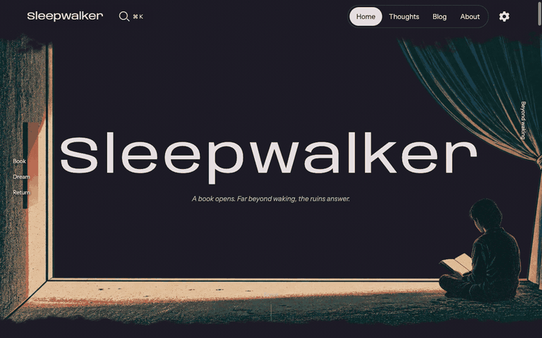

# gazette-theme-nocturne

Nocturne is the dark-first Gazette world used by Sleepwalker. A familiar place opens into an unexpected whole: wide type, plum stock and painted passages create atmosphere while reading and navigation stay precise. [WORLD.md](WORLD.md) describes the accepted painted opening, the page modes and the motifs still to draw.

The [presentation package](presentation.toml) extends `gazette-theme-base`; `design-tokens` supplies the `nocturne` values. Base owns reading, navigation, listings and interaction behavior. This repository supplies the world’s type, material and scene adapters; the composing workspace supplies words, selected imagery and scene records. [Compositions](docs/compositions.md) explains the current selectors, scene components and source bindings.

## Build and check

Bind `theme:nocturne`, `theme:base` and the resources declared by `presentation.toml` in a Gazette workspace. This is a theme package, not a standalone site. Gazette’s `docs/theme-reference.md` explains the package contract; Base’s `docs/start-a-world.md` explains fixture bindings and its README gives the shared verification command.

Change values in `design-tokens`, then run that repository’s `npm run build`, `npm run capture` and `npm run check:captures`. [Token provenance](tokens/SOURCE.md) and [font provenance](fonts/SOURCE.md) record the captured inputs and licences. Reading, italic, system and wide Anybody display faces are delivered as WOFF2 resources.

After a presentation change, inspect the composed page in light and dark, with normal and reduced motion, at wide and handheld widths. Walk the whole opening forward, backward and through interrupted transitions; inspect its native storyboard and opened navigation. A passing build does not establish scene continuity or design acceptance. [AGENTS.md](AGENTS.md) identifies the working rules.

## Licence

Nocturne is licensed under the MIT License with an attribution term: a site built with it keeps a footer credit stating that it was made using Gazette, such as "Made using Gazette", linking to [rawthoughts.in/gazette](https://rawthoughts.in/gazette/), and a link to this repository. [LICENSE](LICENSE) gives the full terms and the files that keep their own. The fonts are under the SIL Open Font License 1.1, with each family's licence in [fonts](fonts/).

The preview shows content from the publication this world was made for, which this repository does not license: footage and artwork purchased from a vendor under licence, and the portrait and publication art of [Harsh](https://getharsh.in). All rights reserved; not for reuse from this repository.
